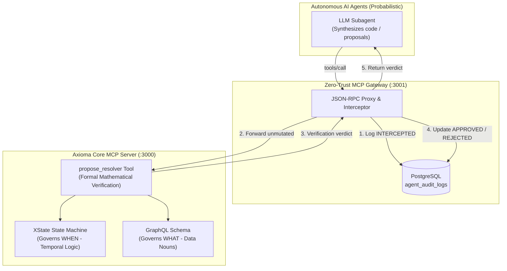

# Axioma: Zero-Trust LLM Governance Framework

[](https://github.com/Michlipski/axioma-mcp-governance/actions)


> Mathematical constraints for non-deterministic AI agents: **XState** (Temporal Logic / Verbs) + **GraphQL AST** (Data Boundaries / Nouns) + **MCP Gateway** (Zero-Trust Auditing & Handoffs).

### Governance Flight Simulator (`/showcase`)
Run the local control plane to inspect live state machines, trigger cross-domain violations, and watch the gateway intercept rogue agent proposals:

```bash
npm run dev
# Open http://localhost:3000/showcase
```

---

## Interactive Showcase: The Governance Flight Simulator

Axioma includes a developer-focused control plane at **[`/showcase`](http://localhost:3000/showcase)** acting as a "Flight Simulator" for system architects to test deterministic LLM governance:

* **Dual-Domain Topology & Active State Boundary Viewer:** Live visual inspection of both finite state machines (`checkoutMachine` and `fulfillmentMachine`), explicitly displaying legal transitions versus mathematically forbidden actions and domain-scoped schemas (`axioma://domains/<domain>/schema`).
* **Agent Intent Dispatcher:** Interactive scenario triggers sending JSON-RPC proposals directly through the Zero-Trust Gateway on port `3001`:
  1. *Rogue Agent: Attempt Discount on Empty Cart* &rarr; **`REJECTED`** (`ILLEGAL_STATE_TRANSITION`)
  2. *Compliant Agent: Execute Legal Payment* &rarr; **`APPROVED`** (Advances to `payment_processing`)
  3. *Rogue Agent: Submit Payment Without Idempotency Key* &rarr; **`REJECTED`** (`MISSING_IDEMPOTENCY_KEY`)
  4. *Rogue Fulfillment Agent: Cross-Domain Mutation* &rarr; **`REJECTED`** (`DOMAIN_BOUNDARY_VIOLATION`)
  5. *Order-Paid Event Handoff: Spawn Fulfillment Worker* &rarr; **`APPROVED`** (Advances to `inventory_allocated`)
  6. *Fulfillment Progression: Print Shipping Label* &rarr; **`APPROVED`** (Advances to `label_printed`)
* **Live Audit Stream:** Real-time stream of `agent_audit_logs` from PostgreSQL with status chips (`INTERCEPTED`, `APPROVED`, `REJECTED`), domain filter chips (`All`, `Checkout`, `Fulfillment`), and expandable JSON inspection drawers.
* **Declarative Scenarios Directory:** Reproducible fixtures under [`showcase/scenarios/`](./showcase/scenarios/) with a 2-minute architectural brief in [`showcase/README.md`](./showcase/README.md).

---

## The Problem: Why Unconstrained LLMs Fail in Production

When LLMs are given direct database access or generic system prompts, they frequently fail in enterprise production environments:
* **Hallucinated State Transitions:** An agent executes payment or fulfillment mutations out-of-order (e.g. paying on an empty or draft cart).
* **Schema Drift & Mutation Inventions:** Agents fabricate parameter names, omit idempotency requirements, or skip crucial audit fields.
* **Invisible Violations:** Standard prompt engineering relies on probabilistic adherence rather than deterministic, enforceable guarantees.

**Axioma solves this by inverting the relationship:**
Instead of letting the AI guess the architecture, **the architecture governs the AI.**



---

## The Three Axiomatic Pillars

### 1. The Temporal Governor: XState State Machine (`checkoutMachine.ts`)
Governs **WHEN** things are permitted to happen. The checkout flow is modeled as a strictly typed finite state machine:
* `empty_cart` $\rightarrow$ `cart_active` $\rightarrow$ `checkout_draft` $\rightarrow$ `pending_payment` $\rightarrow$ `payment_processing` $\rightarrow$ `paid` $\rightarrow$ `fulfilled`
* **Mathematical Invariant:** In `empty_cart` or `checkout_draft`, the `SUBMIT_PAYMENT` transition is mathematically unhandled and illegal.

### 2. The Structural Governor: Rigid GraphQL Schema (`schema.graphql`)
Governs **WHAT** is allowed to change. Defines the rigid data targets:
* Nouns: `Cart`, `CartItem`, `Order`, `OrderLineItem`, `ShippingAddress`, `PaymentTransaction`, `PaymentResult`
* Inputs: `AddItemInput`, `ShippingAddressInput`, `PaymentInput`
* Mutations strictly mapped to state machine events: `createCart`, `addItemToCart`, `initiateCheckout`, `attachShippingAddress`, `submitPayment`, `dispatchFulfillment`

### 3. The Agent's Lens: Model Context Protocol (MCP) Server
Antigravity subagents do not guess backend structure. They query a dedicated local MCP server running over standard I/O:
* **Resources:**
  * `axioma://schema/graphql` — Read-only strictly typed schema.
  * `axioma://machines/checkout` — Read-only XState machine source code.
  * `axioma://machines/json` — Graph representation of states, transitions, and guards.
* **Governance Tools:**
  * `introspect_state`: Discovers admissible events, state invariants, and relevant type subgraphs.
  * `propose_resolver`: Pre-execution validation tool that validates proposed code against transitions, schema types, and database invariants.

---

## The Core Proof: The AI Handoff

The central proof-of-concept for Axioma is the autonomous AI handoff test:

> **Parent Agent Prompt:**  
> *"A user just triggered `SUBMIT_PAYMENT`. Read the MCP resources and generate the backend logic."*

### Execution Trajectory

```
[Agent] Connecting to Axioma MCP Server...
[Agent] Querying boundary: introspect_state(stateName: "pending_payment")
        --> Discovered legal events: ["SUBMIT_PAYMENT", "CANCEL_CHECKOUT"]
        --> Invariant: SUBMIT_PAYMENT requires amountCents === totalCents
        --> Invariant: idempotencyKey must be non-empty string
        --> Target transition: pending_payment -> payment_processing -> paid

[Agent] Reading schema: axioma://schema/graphql
        --> Target mutation: submitPayment(orderId: ID!, input: PaymentInput!): PaymentResult!
        --> Required payload: { idempotencyKey, paymentToken, amountCents, currency }

[Agent] Generating Drizzle ORM / PostgreSQL implementation...
[Agent] Submitting proposal to MCP tool: propose_resolver(...)
```

### Generated Backend Implementation (Enforcing Zero-Trust)

```typescript
async submitPayment(_: unknown, { orderId, input }: { orderId: string; input: PaymentInput }): Promise<PaymentResult> {
  // 1. Idempotency Boundary: Return existing record if idempotencyKey already captured
  const existingTransaction = await db.query.paymentTransactions.findFirst({
    where: eq(schema.paymentTransactions.idempotencyKey, input.idempotencyKey),
  });
  if (existingTransaction) {
    const order = await getOrderWithRelations(orderId);
    return {
      success: existingTransaction.status === 'CAPTURED',
      transaction: existingTransaction,
      order: order!,
    };
  }

  // 2. Fetch order & verify prerequisite status
  const order = await db.query.orders.findFirst({
    where: eq(schema.orders.id, orderId),
  });
  if (!order || order.status !== 'PENDING_PAYMENT') {
    throw new Error(`Order ${orderId} is not in PENDING_PAYMENT status`);
  }

  // 3. Initialize XState checkout actor at pending_payment
  const actor = createCheckoutActor('pending_payment', {
    cartId: order.cartId,
    items: order.lineItems,
    subtotalCents: order.subtotalCents,
    shippingCents: order.shippingCents,
    taxCents: order.taxCents,
    totalCents: order.totalCents,
  });

  // 4. Dispatch SUBMIT_PAYMENT (XState verifies idempotencyKey & amount matching)
  actor.send({
    type: 'SUBMIT_PAYMENT',
    idempotencyKey: input.idempotencyKey,
    amountCents: input.amountCents,
  });
  const processingSnapshot = actor.getSnapshot();
  if (processingSnapshot.value !== 'payment_processing') {
    throw new Error('State machine rejected SUBMIT_PAYMENT transition');
  }

  // 5. Gateway settlement & transition to paid
  const paymentTransactionId = crypto.randomUUID();
  actor.send({
    type: 'PAYMENT_SUCCESS',
    paymentId: paymentTransactionId,
  });
  const paidSnapshot = actor.getSnapshot();
  if (paidSnapshot.value !== 'paid') {
    throw new Error('State machine failed to reach paid state');
  }

  // 6. Project payment transaction to PostgreSQL
  const [transaction] = await db
    .insert(schema.paymentTransactions)
    .values({
      id: paymentTransactionId,
      orderId,
      idempotencyKey: input.idempotencyKey,
      amountCents: input.amountCents,
      currency: input.currency || 'USD',
      status: 'CAPTURED',
      gatewayReference: `gtw_${Date.now()}`,
    })
    .returning();

  // 7. Project order status to PAID
  await db
    .update(schema.orders)
    .set({ status: 'PAID', updatedAt: new Date() })
    .where(eq(schema.orders.id, orderId));

  // 8. Project cart conversion
  await db
    .update(schema.carts)
    .set({ status: 'CONVERTED', updatedAt: new Date() })
    .where(eq(schema.carts.id, order.cartId));

  const updatedOrder = await getOrderWithRelations(orderId);
  return {
    success: true,
    transaction,
    order: updatedOrder!,
  };
}
```

### The MCP Verification Verdict

```json
{
  "status": "APPROVED",
  "sourceState": "pending_payment",
  "targetState": "payment_processing",
  "validatedGuards": [
    "hasIdempotencyKey",
    "validPositiveAmount"
  ],
  "feedback": "Proposal successfully validated! Legal transition from 'pending_payment' to 'payment_processing' via 'SUBMIT_PAYMENT'. Conforms to GraphQL mutation 'submitPayment' and strict database invariants."
}
```

---

## Negative Proofs & Showcase Scenarios: What Happens When an AI Violates Boundaries?

To prove the governance system is active rather than advisory, the test suite and showcase simulator verify strict rejection of invalid proposals:

| Scenario Fixture | Attempted Action | MCP Governance Verdict |
| :--- | :--- | :--- |
| [**01-illegal-discount-on-empty-cart.json**](./showcase/scenarios/01-illegal-discount-on-empty-cart.json) | Triggering `APPLY_DISCOUNT` from `empty_cart` | `REJECTED`: `ILLEGAL_STATE_TRANSITION`<br>*"In state 'empty_cart', triggering 'APPLY_DISCOUNT' is mathematically impossible."* |
| [**03-missing-idempotency-key.json**](./showcase/scenarios/03-missing-idempotency-key.json) | Omitting `idempotencyKey` from payment payload | `REJECTED`: `MISSING_IDEMPOTENCY_KEY`<br>*"Payload must provide a non-empty string idempotencyKey"* |
| **Out-of-Order Transition** | Triggering `SUBMIT_PAYMENT` from `empty_cart` | `REJECTED`: `ILLEGAL_STATE_TRANSITION`<br>*"Event 'SUBMIT_PAYMENT' is not admissible from state 'empty_cart'"* |
| **Financial Under/Overcharge** | Submitting `amountCents` mismatching `totalCents` | `REJECTED`: `INVALID_AMOUNT`<br>*"amountCents must be a positive integer matching totalCents"* |
| **Hallucinated Mutation** | Proposing `arbitraryDirectBypass` | `REJECTED`: `GRAPHQL_MUTATION_NOT_FOUND`<br>*"Mutation does not exist in schema.graphql"* |
| [**02-valid-checkout-and-payment.json**](./showcase/scenarios/02-valid-checkout-and-payment.json) | Compliant payment with idempotency & exact amount | `APPROVED`<br>*"Legal transition from 'pending_payment' to 'payment_processing'."* |

---

## Project Structure

```
axioma/
├── showcase/
│   ├── README.md                 # 2-minute showcase architectural brief
│   └── scenarios/
│       ├── 01-illegal-discount-on-empty-cart.json  # Rogue agent empty cart discount fixture
│       ├── 02-valid-checkout-and-payment.json      # Compliant agent payment fixture
│       ├── 03-missing-idempotency-key.json         # Guard failure fixture
│       ├── 04-cross-domain-boundary-violation.json # Cross-domain rogue worker violation
│       ├── 05-cross-domain-handoff-success.json    # Event-driven handoff & allocation fixture
│       └── 06-legal-fulfillment-progression.json   # Legal fulfillment label printing fixture
├── src/
│   ├── app/
│   │   ├── showcase/page.tsx     # Governance Flight Simulator control plane
│   │   ├── governance/page.tsx   # Live PostgreSQL telemetry dashboard
│   │   ├── api/audit-logs/       # Audit feed API route (Drizzle ORM)
│   │   ├── api/graphql/          # Apollo GraphQL server route
│   │   └── page.tsx              # Interactive checkout sandbox
│   ├── gateway/
│   │   └── server.ts             # Zero-Trust MCP Gateway proxy (:3001 -> :3000)
│   ├── machines/
│   │   ├── checkoutMachine.ts    # Formal XState v5 checkout finite state machine
│   │   └── fulfillmentMachine.ts # Formal XState v5 fulfillment finite state machine
│   ├── graphql/
│   │   ├── schema.graphql        # Rigid GraphQL nouns & mutations (Checkout)
│   │   ├── schema.fulfillment.graphql # Scoped shipping & inventory nouns (Fulfillment)
│   │   └── resolvers.ts          # State-machine projected resolvers
│   ├── mcp/
│   │   ├── server.ts             # Model Context Protocol server, tools, & resources
│   │   ├── http.ts               # Core MCP HTTP server (:3000)
│   │   └── index.ts              # MCP stdio executable daemon
│   └── db/
│       ├── schema.ts             # PostgreSQL tables: carts, orders, agent_audit_logs
│       └── index.ts              # Drizzle ORM connection pool
├── tests/
│   ├── crossDomain.test.ts       # Cross-domain handoff & isolation tests
│   ├── showcase.test.ts          # Showcase fixtures & invariant verification
│   ├── gateway.test.ts           # Gateway proxy, decompression, & telemetry tests
│   ├── checkoutMachine.test.ts   # Formal state machine mathematical invariant tests
│   ├── mcp.test.ts               # MCP server resources, tools, and proposal validation
│   └── resolvers.test.ts         # Apollo Server zero-trust execution tests
└── docs/
    └── trace/SPEC.md             # Declarative system specification
```

---

## Quickstart & Flight Simulator

### 1. Install Dependencies
```bash
npm install
```

### 2. Run the Full Test Suite (58 Invariant Tests)
```bash
npm test
```

### 3. Launch the Governance Flight Simulator
```bash
# Terminal 1: Core MCP HTTP Server (Port 3000)
npm run mcp:server

# Terminal 2: Zero-Trust MCP Gateway Proxy (Port 3001)
npm run mcp:gateway

# Terminal 3: Next.js Showcase Control Plane
npm run dev
```

Navigate to **`http://localhost:3000/showcase`** in your browser to test live scenario dispatches against the Gateway proxy!

### 4. Query the MCP Server via CLI
```bash
# Introspect state boundary
npx tsx scripts/mcp-query.ts introspect pending_payment

# Inspect schema resource
npx tsx scripts/mcp-query.ts resource schema

# Validate a proposal
npx tsx scripts/mcp-query.ts propose showcase/scenarios/02-valid-checkout-and-payment.json
```

---

## Author & Architecture Notes

Built by **Michael Lipski** to demonstrate deterministic, zero-trust AI coding agent governance using formal finite state machines, typed schemas, and the Model Context Protocol (MCP).
